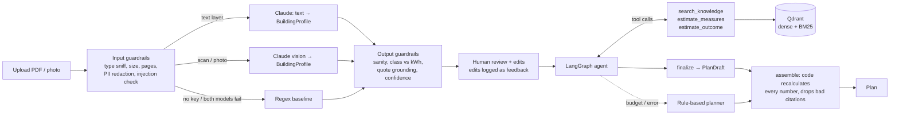

# Architecture and decisions

## Flow

Every box writes spans to the tracer: model, tokens, cost, latency, status, fallback and prompt version.

## Key decisions

**1. The model decides what, the code calculates how much.**
The agent picks measures and explains why. Costs, grants, CO₂, energy class and the rent levy all come from `domain/calculators.py`, from reference tables. That removes the most damaging kind of hallucination, a wrong number in front of a landlord. The numbers are deterministic and unit tested, for example the grant caps match the official 8-unit example of €121,000 and €240,000.

**2. Text first, vision only when needed.**
If a PDF has a text layer, the backend redacts the text and sends only that. This is cheaper and faster, and it lets the backend check that every extracted value's quote really appears in the document. Scans and photos go to Claude as images. There the quotes cannot be checked, so confidence is capped at 0.8 and review becomes more likely.

**3. Structured output everywhere.**
`BuildingProfile`, `PlanDraft` and `AnswerDraft` are Pydantic schemas sent as JSON schema. A parse failure triggers the fallback model instead of a crash. (Sonnet 5.5 does not support forced tool calling, so the client uses `method="json_schema"`. The LangChain integration warns about this.)

**4. Hybrid retrieval.**
Dense multilingual embeddings handle paraphrases and German or English mixing ("Zuschuss Dämmung" and "insulation grant"). BM25 sparse vectors catch exact terms that embeddings blur, such as "iSFP", "KfW 458" and "§ 559". Qdrant fuses the two with Reciprocal Rank Fusion. The eval compares hybrid, dense and sparse search on the same golden set.

**5. Citations are verified, not trusted.**
The agent's tool node records every chunk it retrieved. When the plan is assembled, any citation id that was not retrieved is removed and flagged. In Q&A, an answer with no valid citation is withheld.

**6. Fallbacks at three levels.**
- API level: the SDK retries with backoff, then a timeout, then the fallback model (`with_fallbacks`).
- Feature level: regex extraction, a rule-based planner and extractive answers when AI is unavailable.
- Budget level: each run has a USD cap. The callback raises `BudgetExceeded`, which skips the fallback model (it is not in `FALLBACK_ON`) and goes straight to the non-AI path.

Every fallback is visible to the user as a chip and counted in metrics as fallback rate.

**7. Human in the loop as a data source.**
Users can edit any extracted field before planning. Each edit is stored as feedback with the predicted and corrected values. That is the signal for which fields the model gets wrong, and the edits can be promoted into `evals/datasets/extraction.jsonl`.

**8. Observability without a vendor.**
A small LangChain callback writes LLM spans, and context managers write tool, retrieval and guardrail spans, all to SQLite. `/api/metrics` gives p50/p95 latency, error rate, fallback rate, review rate and cost per feature and per model. If Langfuse keys are set, the same LangChain events also go to Langfuse. In production I would export OpenTelemetry to the team's existing stack.

**9. Reusable building blocks.**
One LLM client, one tracer, versioned prompt files whose version is attached to each trace, and typed schemas. A new squad gets retries, fallback, cost tracking and eval hooks by calling `client.structured(Schema, name=...)`.

## Evaluation

| Suite | Needs LLM | Metrics |
|---|---|---|
| retrieval | no | hit@5, MRR for hybrid, dense and sparse search |
| guardrails | no | regex baseline accuracy, recall of expected issues (injection, class mismatch) |
| extraction | yes | field accuracy over 8 samples (text, scan, photo, injection, inconsistent) |
| answers | yes | must-mention rate, correct refusal of off-topic questions, LLM-as-judge faithfulness 1–5 |
| planning | yes | valid citation rate, plans without errors |

`evals/thresholds.json` sets the gates. CI fails if a metric drops below its threshold, which catches regressions when someone changes a prompt or a model.

## Known limitations and next steps

- The knowledge base is small and hand-written. In production I would ingest official BAFA and KfW documents with versioning and a "valid from" date per chunk.
- Cost and saving factors are rough averages. Real estimates need geometry from plans or a site visit. Multimodal floor-plan reading is the natural next feature.
- The eval set is small (8 certificates, 14 questions). Next I would grow it from user corrections and add a second, independent judge model.
- SQLite telemetry suits a single instance. In production I would use OpenTelemetry, a proper backend and alerts on p95, error rate and daily spend.
- There is no auth or multi-tenancy.
- The heat pump is sized with a simple full-load-hours rule. A real design needs a heat load calculation (DIN EN 12831).
